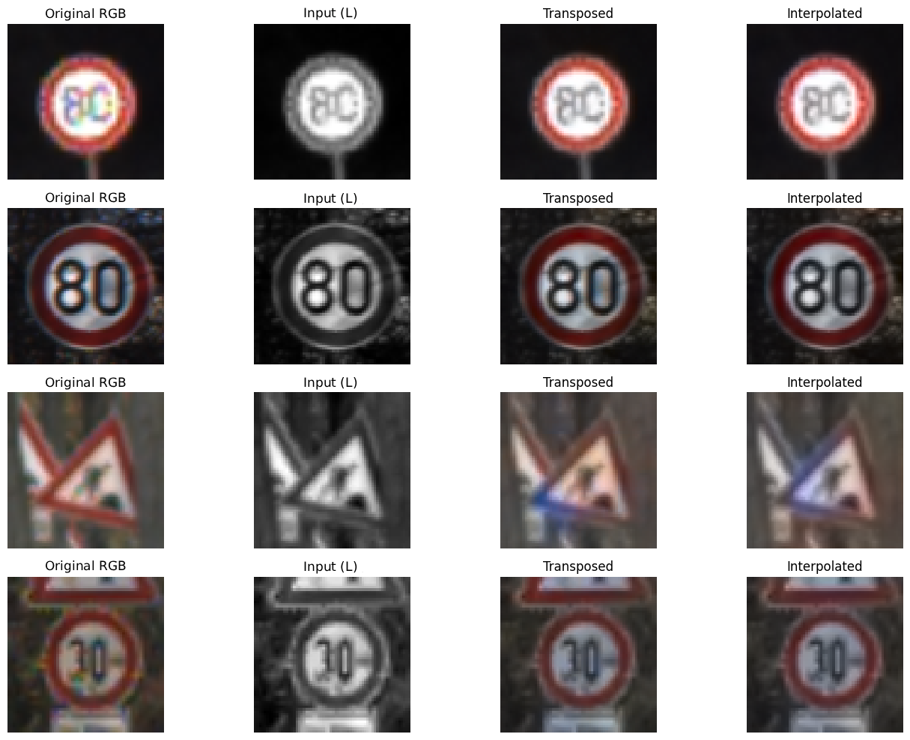
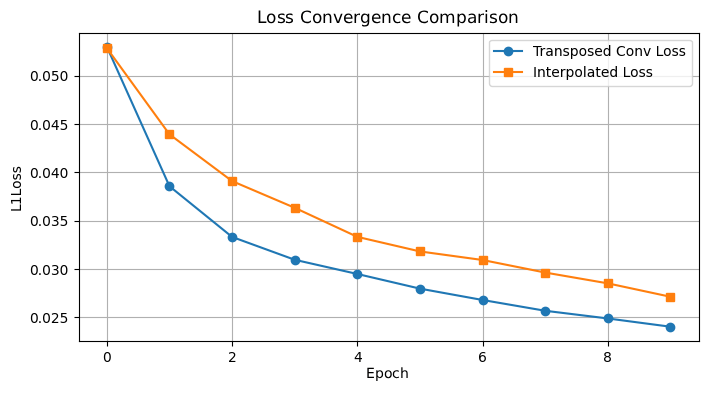

# Traffic Sign Image Colorization

## Overview

This project explores automatic colorization of grayscale traffic sign images using deep learning. Two convolutional autoencoder architectures are implemented and compared to investigate different approaches to image reconstruction.

The models take grayscale images as input and learn to reconstruct their color information while preserving the original image structure and details.

## Dataset

The project uses the **German Traffic Sign Recognition Benchmark (GTSRB)** dataset.

- **Training set:** 26,640 images
- **Test set:** 12,630 images
- **Image resolution:** 64 × 64 pixels

All images are resized to 64 × 64 pixels before being used in the experiments.

## Methodology

The colorization task is performed in the **CIELAB color space**, which separates image brightness from color information.

- **L channel:** Represents image lightness and is used as the model input.
- **a and b channels:** Represent color information and serve as prediction targets.

By separating luminance from color, the models can focus on predicting the missing color information while retaining the original image brightness and structure.

## Model Architectures

Two convolutional autoencoders with a shared encoder architecture are implemented and compared.

### 1. Transposed Convolution Autoencoder

- Uses a convolutional encoder with four downsampling layers.
- The decoder consists of transposed convolutional layers.
- Reconstructs the color channels from the grayscale input.

### 2. Interpolation + Convolution Autoencoder

- Uses the same encoder architecture as the first model.
- The decoder combines bilinear interpolation with standard convolutional layers.
- Gradually increases spatial resolution to reconstruct the color channels.

## Training Configuration

Both models are trained using the same configuration to ensure a fair comparison.

| Parameter | Value |
|---|---|
| Framework | PyTorch |
| Optimizer | Adam |
| Learning rate | 0.001 |
| Loss function | L1 Loss |
| Number of epochs | 10 |
| Batch size | 64 |
| Input resolution | 64 × 64 |

## Results

### Visual Results

The following examples show the colorization results produced by the models.

### Training Loss Comparison

Both architectures demonstrate a decrease in training loss throughout the training process.

| Model | Initial Training Loss | Final Training Loss |
|---|---:|---:|
| Transposed Convolution AE | 0.05300 | 0.02403 |
| Interpolation + Convolution AE | 0.05285 | 0.02713 |

The **Transposed Convolution Autoencoder** achieves a lower final training loss than the Interpolation + Convolution architecture.

Visual comparisons on test images show no substantial differences between the two approaches.

Additional experiments with external images suggest that the models can produce reasonable results on images resembling the training dataset. However, their performance significantly decreases when processing images from different environments.

## Technologies Used

- Python
- PyTorch
- Torchvision
- NumPy
- Matplotlib
- Jupyter Notebook

## Conclusion

This project explores two decoder architectures for image colorization using convolutional autoencoders.

Both approaches successfully learn to reconstruct color information from grayscale traffic sign images. Based on the training results, the Transposed Convolution Autoencoder achieves a lower final loss, while visual comparisons show broadly similar colorization results from both models.
